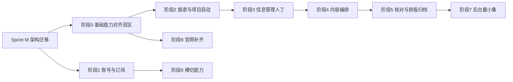

# 家传云谱 · MVP 未完成步骤计划

**依据文档**：[`家传云谱·数字管理平台产品设计文档_v3.1.md`](./家传云谱·数字管理平台产品设计文档_v3.1.md) **v3.1.6（开发基线·冻结）**  
**迁移说明**：[`家传云谱·v2.2.1→v3.1.x迁移说明书.md`](./家传云谱·v2.2.1→v3.1.x迁移说明书.md)  
**历史对照（已废止）**：[`家传云谱·产品设计文档.md`](./家传云谱·产品设计文档.md) v2.2.1  
**对照范围**：当前 `frontend` 代码库（截至计划更新日：仍多处按 v2.2.1 六步实现）  
**文档目的**：按模块、分步骤列出相对 **v3.1.6** 产品基线**尚未完成**的工作；**须先完成 Sprint M 架构迁移，再继续业务 Sprint**。

> **2026-09-15 基线切换**：开发依据由 v2.2.1 切换为 v3.1.6。下列「阶段 3 数据采集」等旧表述在 Sprint M 完成后应改为「信息管理 / 五步流程」口径；迁移任务以迁移说明书 §6 为准。

---

## 一、现状总览

### 1.1 已具备（脚手架 / 局部完成）

| 模块 | 现状 | 与产品文档差距 |
|------|------|----------------|
| 工程脚手架 | Vue3 + TS + Element Plus + 布局/权限框架 | 菜单与页面仍是模板演示结构 |
| 官网落地页 | 首页各区块已落地（Hero/价值/流程/功能/版式/案例/定价/FAQ/页脚备案等） | 缺独立「产品功能页」「关于我们」；案例偏占位；备案号为占位 |
| 登录 / 注册 / 忘记密码 | 有页面骨架；登录去掉身份选择，有第三方入口 UI | **非**手机号验证码登录；微信/QQ/手机验证仅占位；个人中心未对齐产品字段 |
| 工作台 | `/dashboard/console` 已是一级菜单，但内容为模板图表 | 非 §3.4 前台「工作台」、亦非 §2.3 后台工作台 |
| 系统管理模板 | 用户 / 角色 / 菜单 / 个人中心（模板页） | 不等于产品后台「系统管理」六 Tab，也不等于前台个人中心三子页 |
| API | 仅有 `auth`、`system-manage` | 无族谱 / 人物 / 订阅 / 订单等业务接口封装 |

### 1.2 结论（一句话）

**产品 MVP 的业务主路径（建谱 → 录人/关系 → 章节 → 牒记式 PDF → 归档 + 订阅额度）在前端几乎尚未按产品菜单与页面落地；当前主要是官网 + 管理端脚手架。**

### 1.3 本计划不纳入（Out of Scope / V1.5+）

以下按产品文档 §0.3.3 **不做进 MVP 排期**（仅允许数据模型预留或入口隐藏标注「V1.5 上线」）：

- 多族谱管理（MVP 硬限制 `max_genealogy_count=1`）
- 多期续修功能开发（入口隐藏 + 标注）
- 苏式正式版 / 宝塔式 / 欧式（苏式仅可独立 Spike）
- 主编 / 校勘 / 只读全角色与双审强制流程
- 家族文化：姓氏源流 / 堂号起源 / 相册
- 高级协作、运营工具、完整分享传播（V2.0）
- 移动端 App

---

## 二、推荐总交付节奏（依赖关系）

**Sprint M（必须先做）**：六步→五步、`Stage` 1–5、双区菜单、采集→信息管理、进度条 barIndex、layout_dirty / 简易一键确认。详见迁移说明书 §6（M1–M8）。

建议：**先完成 Sprint M，再前后端契约与业务页**；前端严格按 v3.1.6 §3.3 双区菜单建路由。

---

## 二附 · Sprint M 检查清单（摘自迁移说明书）

| 步骤 | 工作项 | 状态 |
|------|--------|------|
| M1 | 类型/Mock：Stage 1–5、stage 映射、layoutDirty | 已完成 |
| M2 | stage.ts + 进度条 + barIndex（标准5/简易4） | 已完成 |
| M3 | 路由双区 + info + collect 重定向 | 已完成 |
| M4 | collect→info；工作台广录族人行动卡 | 已完成 |
| M5 | 五步推进/回退/门禁；校对文案 | 已完成 |
| M6 | layout_dirty + 标准回校对 / 简易一键确认 | 已完成 |
| M7 | i18n 与可见文案清理 | 已完成 |
| M8 | Mock 五步首修冒烟 | 已完成（vue-tsc 通过） |

---

## 三、分模块步骤计划

> 状态标记：`未开始` / `进行中` / `部分完成`  
> 优先级对齐产品 §0.3.1：`P0` / `P1` / `P2`

---

### 阶段 0 · 基础能力与信息架构（阻塞项）

**目标**：让后续每个业务页有正确的菜单、路由、布局与拦截骨架。

| 步骤 | 工作项 | 依据 | 状态 |
|------|--------|------|------|
| 0.1 | 梳理前后台双端入口：前台用户端 vs 后台运营端（路由前缀/布局/角色分流） | §2 / §3 | 部分完成 |
| 0.2 | 重做**前台全局菜单**：工作台、我的族谱、会员订阅中心、个人中心 | §3.3 | 部分完成 |
| 0.3 | 实现「进入族谱 / 退出族谱」切换单族谱菜单（10 项阶段菜单） | §3.3 | 已完成 |
| 0.4 | 侧栏「仅显示已到达及之前阶段」+ 总览页进度条跳转 | §0.6.2 / §1.x / §3.3 | 已完成 |
| 0.5 | 顶栏补齐「当前族谱常驻名称标识」；去掉与产品无关的模板能力（已关搜索） | §3.2 | 已完成 |
| 0.6 | 统一空态 / 加载 / 二次确认 / 订阅过期与额度拦截中间件（前端拦截层） | §4.2 / §4.4 | 未开始 |
| 0.7 | 按文档实体补齐 TypeScript 类型与 `api/*` 模块骨架（Genealogy/Person/Project…） | 第一部分实体 | 部分完成 |
| 0.8 | 清理或降级模板路由（result/exception 可留；演示向 system 菜单与业务脱钩） | 工程规范 | 部分完成 |

**产出**：可切换的全局菜单 / 族谱内菜单；拦截与 API 类型骨架。

---

### 模块 A · 用户注册登录与账号管理（P0）

**目标**：手机号验证码登录为主路径（产品 §0.3.1）。

| 步骤 | 工作项 | 说明 | 状态 |
|------|--------|------|------|
| A1 | 登录改为「手机号 + 验证码」主流程 | 账号密码可作为辅，或合并到同一页 Tab | 部分完成 |
| A2 | 注册：手机号验证码 + 协议强制同意 | 对齐隐私政策 / 用户协议 | 部分完成 |
| A2b | 注册表单「族谱邀请码」（选填）+ 带码入成员 | v3.1.7 候选；见《族谱成员与邀请码设计说明》§7.1；**≠协作邀请** | 已完成（Mock；演示码 YCDEMO01） |
| A3 | 忘记密码：验证码重置 | 密码强度：≥8 位且字母+数字 | 部分完成 |
| A4 | 打通真实鉴权（token / 刷新 / 登出 / 登录态跳转工作台） | Mock 登录可进工作台；真后端待联调 | 部分完成 |
| A5 | 微信 / QQ 第三方登录 | 文档未列 P0；可保持「即将上线」或移入 V1.5 | 占位 UI |
| A6 | 前台个人中心：账号信息 / 修改密码 / 消息通知（路由二级或 Tab） | §3.4 页面 14；现页为模板字段 | 部分完成 |
| A6b | 个人中心 / 我的族谱：「邀请码加入族谱」 | 成员只读；不占协作席位；专题 §7.2–7.3 | 已完成（Mock + 权限设置成员 Tab） |

**验收**：未登录可走官网→注册/登录；登录后进「工作台」；无演示身份下拉。

---

### 模块 B · 订阅体系与额度（P0）

**目标**：试用 + 基础年付 + 额度管控闭环。

| 步骤 | 工作项 | 依据 | 状态 |
|------|--------|------|------|
| B1 | 会员订阅中心路由与四子页：我的套餐 / 购买续费 / 额度流水 / 我的订单 | §3.3 / §3.4 页面 13 | 已完成 |
| B2 | 套餐展示与购买（对接支付：微信/支付宝，可先 Mock） | 订阅实体 | 已完成（Mock 即时支付） |
| B3 | 额度展示与消耗提示（人物额度 / 存储额度） | §4.2 | 已完成 |
| B4 | 过期 / 额度用尽分场景拦截（禁增可改 vs 全只读） | 文档冲突修复结论 / §0.8 | 已完成 |
| B5 | 工作台 / 我的族谱 / 定稿导出等入口联动拦截横幅 | §3.4 页面 01 | 已完成 |

**验收**：试用可建 1 个族谱；额度用尽不能新增人物；订阅过期仅只读。

> **2026-09-15 进度（模块 B）**：落地 Mock 订阅 store（`mock/subscription.ts`）、订阅中心四 Tab、套餐/扩容 Mock 支付、额度流水与订单；`useSubscriptionGuard` + 人物/族谱/阶段/PDF 写路径拦截；工作台横幅与额度卡接真实摘要；「我的套餐」提供模拟过期/额度用尽便于验收。真实微信/支付宝支付待后端联调。

---

### 模块 C · 单族谱创建与基础设置（P0）

**目标**：我的族谱列表 + 创建弹窗 + 回收站。

| 步骤 | 工作项 | 依据 | 状态 |
|------|--------|------|------|
| C1 | 「我的族谱」列表页（卡片、筛选、分页） | §3.4 页面 02 | 已完成 |
| C2 | 创建族谱弹窗：族谱名、堂号、始祖、隐私、**标准/简易模式** | §0.3.2 / §3.4 | 已完成 |
| C3 | 编辑基础信息、公开/私有切换 | 同上 | 已完成 |
| C4 | 删除→回收站（30 天恢复）/ 彻底删除（验证码） | 回收站规则 | 已完成 |
| C5 | 创建成功生成空族谱 + 默认初始修谱项目，并进入族谱总览 | 流程 | 已完成 |
| C6 | MVP：`max_genealogy_count=1` 前端硬限制与提示 | §0.3.3 | 已完成 |

**验收**：从工作台/我的族谱可创建并进入族谱上下文。

---

### 模块 D · 族谱总览与六步流程壳（P0 骨架）

**目标**：总览页 + 进度条 + 各阶段页面壳与推进/回退。

| 步骤 | 工作项 | 依据 | 状态 |
|------|--------|------|------|
| D1 | 族谱总览：信息卡、统计、快捷入口 | §3.4 页面 03 | 已完成 |
| D2 | 进度条：**五步成谱** vs **快捷成谱**（含「已跳过会审」标注） | §0.6.2 | 已完成 |
| D3 | 各阶段页面路由与底部「推进 / 回退」按钮组件 | §3.4 页面 04–09 | 已完成 |
| D4 | 简易模式隐藏质量审核菜单与相关推进 | §0.3.2 | 已完成 |
| D5 | 标准模式 MVP：拥有者代行校勘+终审（不做全角色双审） | §0.3.3 | 部分完成（壳页说明，审核业务待 H） |

---

### 模块 E · 项目启动（阶段 1，P0）

| 步骤 | 工作项 | Tab | 状态 |
|------|--------|-----|------|
| E1 | 项目信息（名称、干支+公元、类型） | 项目信息 | 已完成（Mock） |
| E2 | 凡例富文本；权威写入 Chapter（fanli），Project.fanli 仅缓存 | 凡例编写 | 部分完成（本地快照 Mock） |
| E3 | 团队配置：MVP 仅拥有者+采编邀请 | 团队配置 | 已完成（Mock） |
| E4 | 推进至数据采集 | — | 已完成 |

---

### 模块 F · 人物数据采集与亲属关系（阶段 2，P0）

| 步骤 | 工作项 | 优先级 | 状态 |
|------|--------|--------|------|
| F1 | 人物列表 CRUD（讳字号行第字辈生卒等） | P0 | 已完成（Mock） |
| F2 | 人物回收站与额度返还规则 | P0 | 已完成（Mock） |
| F3 | Excel 批量导入（辅） | P0 | 已完成（Mock） |
| F4 | 亲属关系：父子、配偶、出继/嗣子等核心关系 | P0 | 已完成（Mock） |
| F5 | 世系图可视化（缩放拖拽） | P1 | 已完成（苏式分代垂丝 SVG；滚轮缩放+拖拽平移；配偶虚线） |
| F6 | 字辈派语设置与「可存+存疑」校验 | P1 | 已完成（列表+诗格+弹窗增删改；录人自动匹配可手选；存疑策略） |
| F7 | 推进至内容编排 | P0 | 已完成 |

---

### 模块 G · 谱书章节 / 内容编排（阶段 3，P0）

| 步骤 | 工作项 | 状态 |
|------|--------|------|
| G1 | 章节管理：凡例、谱序、传记等富文本、排序 | 已完成（Mock） |
| G2 | 世系规整（只读预览 + 缺失/异常提示） | 已完成（Mock） |
| G3 | 初审检查清单（缺失字段、异常关系、敏感词） | 已完成（Mock） |
| G4 | 简易模式：推进目标改为排版定稿（跳过审核） | 已完成 |

---

### 模块 H · 质量审核（阶段 4，MVP 裁剪）

| 步骤 | 工作项 | 说明 | 状态 |
|------|--------|------|------|
| H1 | 标准模式：待审列表 / 疑点台账 / 审核记录（拥有者代行） | 非全角色双审 | 已完成（Mock） |
| H2 | 简易模式：不展示本阶段 | §0.3.2 | 已完成 |
| H3 | 存疑上限 5% 等规则校验 | §3.4 页面 07 | 已完成（Mock） |

---

### 模块 I · 牒记式排版 + PDF + 归档（阶段 5–6，P0）

| 步骤 | 工作项 | 说明 | 状态 |
|------|--------|------|------|
| I1 | 智能排版：默认牒记式；其它版式入口隐藏或标 V1.5 | §0.3.1 / §0.3.3 | 已完成（Mock 预览） |
| I2 | 版式锁定 / 解锁回退规则 | §3.4 页面 08 | 已完成（Mock） |
| I3 | 印刷版 PDF 生成与下载（异步任务+进度） | §1.11 | 已完成（Mock 任务） |
| I4 | 发布归档：版本快照封存只读 | P0 | 已完成（Mock） |
| I5 | 版本对比、续修发起 Tab：**隐藏并标注 V1.5** | §0.3.3 | 已完成（入口禁用） |
| I6 | （可选）苏式垂丝 Spike 独立分支，不阻塞主路径 | Spike | 未开始 |

---

### 模块 J · 协作成员（P1）

| 步骤 | 工作项 | 状态 |
|------|--------|------|
| J1 | 设置与协作 · 协作成员：邀请采编、权限说明 | 已完成（权限管理·角色管理：成员列表、邀请采编、席位上限、权限对照表；Mock） |
| J2 | 操作日志 Tab | 已完成（权限设置·操作日志：类型/人员/时间筛选 + 列表 + 详情；邀请/移除写日志；Mock） |
| J3 | 基础设置 / 隐私权限 Tab | 已完成（名称/姓氏/堂号/始祖；隐私模式+在世脱敏；简易升标准；分享入口预留模块 M） |

---

### 模块 K · 附件档案（P1）

| 步骤 | 工作项 | 状态 |
|------|--------|------|
| K1 | 资料档案：分类浏览、上传、预览、删除（走存储额度） | 已完成（分类筛选、上传/预览/下载、回收站恢复与彻底删除；存储占用联动；Mock） |
| K2 | 图片缩略图与大小拦截（文档 §5.2） | 已完成（单文件 ≤10MB 拦截；图片 canvas 缩略图；大文件不落盘完整内容） |

---

### 模块 L · 家族文化最小集（P2）

| 步骤 | 工作项 | 状态 |
|------|--------|------|
| L1 | 家族文化页 Tab：家规家训 + 家族大事记 | 已完成（条目 CRUD/排序/富文本；大事记时间轴+列表+关联人物；Mock） |
| L2 | 姓氏源流 / 堂号 / 相册：隐藏或标 V1.5 | 已完成（入口保留并标 V1.5，页内占位说明） |

---

### 模块 M · 族内只读分享（P2，MVP 末段）

| 步骤 | 工作项 | 状态 |
|------|--------|------|
| M1 | 拥有者生成只读链接 | 已完成（隐私设置内生成/复制/撤销；7/30/90/永久；Mock） |
| M2 | 无登录或轻量访问下的只读浏览（在世脱敏） | 已完成（`/s/:token` 公开页；最严格脱敏；私密人物隐藏） |

---

### 模块 N · 后台管理最小集（P2）

产品后台 7 个一级菜单；MVP 最小集强调：**用户列表 + 订单列表 + 审计日志**（内容审核/敏感词降 V1.5）。

| 步骤 | 工作项 | MVP？ | 状态 |
|------|--------|-------|------|
| N1 | 后台工作台（核心指标卡，可先简化） | 建议有 | 已完成（`/ops/dashboard` 指标卡+阶段分布+预警；Mock） |
| N2 | 用户与订阅 · 用户账号列表（冻结/解冻，禁删） | **必做** | 已完成（筛选/分页/冻结解冻写审计；禁删；Mock） |
| N3 | 订单与财务 · 订单列表 | **必做** | 已完成（状态筛选/详情；复用订阅订单 Mock） |
| N4 | 系统管理 · 审计日志 | **必做** | 已完成（`/ops/audit` 筛选/详情；永久留存；Mock） |
| N5 | 内容管理 / 内容审核 / 工单 / 商品配置等 | 可排 V1.0 后半或 V1.5 | 未开始 |
| N6 | 将现有模板「用户/角色/菜单」迁移或映射为后台系统管理 Tab | 工程债 | 未开始 |

---

### 模块 O · 官网补齐（对照官网设计文档 §十三）

| 步骤 | 工作项 | MVP？ | 状态 |
|------|--------|-------|------|
| O1 | 首页完整度打磨（真实案例/截图替换占位） | 是 | 部分完成（结构完整；案例/截图仍为示意，可后续替换） |
| O2 | 独立产品功能页（简化 6 模块） | 是 | 已完成（`/features`） |
| O3 | 定价页（可与首页锚点并存或独立路由） | 是 | 已完成（`/pricing` + 首页锚点并存） |
| O4 | 关于我们（简化） | 是 | 已完成（`/about`） |
| O5 | 帮助中心 FAQ（已有）→ 完整文章 | FAQ 有；文章 V1.5 | 部分完成（首页 FAQ；文章 V1.5） |
| O6 | 真实 ICP / 公安备案号替换占位 | 上线前必做 | 占位 |
| O7 | 案例页 / 博客 / 更新日志 | V1.5 | 未开始 |

---

## 四、建议冲刺切片（可直接排期）

### Sprint 1（打底）

1. 阶段 0（菜单 / 族谱上下文 / API 类型 / 拦截骨架）  
2. 模块 A（手机号登录闭环）  
3. 模块 B（订阅与额度最小可用 + Mock 支付）

> **2026-09-14 进度**：已落地 `VITE_USE_MOCK`、前台全局菜单（`/console` `/genealogies` `/subscription` `/account`）、工作台等占位页、验证码登录/注册/重置；族谱上下文 store 与顶栏名称位已预留。模块 B 购买闭环与 0.3 阶段菜单切换待下一迭代。

### Sprint 2（建谱闭环起点）

1. 模块 C（我的族谱 + 创建）  
2. 模块 D（总览 + 进度条 + 阶段壳）  
3. 模块 E（项目启动）

> **2026-09-14 进度**：已落地进入/退出族谱菜单切换、`/g/:id/*` 十项路由、我的族谱 CRUD+回收站（max=1）、总览与五步成谱/快捷成谱进度条、阶段壳与推进回退、项目启动三 Tab（Mock）。模块 B 与人物采集（F）待后续 Sprint。

### Sprint 3（数据主路径）

1. 模块 F1–F4、F7（人物 + 关系）  
2. 模块 G（章节 + 初审）

> **2026-09-15 进度**：字辈列表（弹窗增删改、诗格、录人自动匹配）收口为 F6 已完成；关系图谱「世系图」Tab 落地苏式分代垂丝 SVG（缩放/拖拽）。J1 角色管理：邀请采编、席位上限、权限对照表已落地（Mock）。
> **2026-09-16 进度**：J2 操作日志 Tab（筛选/分页列表/详情弹窗）已落地；协作邀请与移除写入日志。J3 基础设置/隐私权限（含脱敏级别、模式升级）已落地。模块 K 资料档案（上传/预览/回收站/存储额度/缩略图与 10MB 拦截）已落地。Sprint 5：L 家族文化（家规+大事记）与 M 族内只读分享（生成链接 + `/s/:token`）已落地。

### Sprint 4（输出闭环）

1. 模块 H（标准模式精简审核）或简易模式直达定稿  
2. 模块 I（牒记式 + PDF + 归档）  
3. 端到端验收：建谱→录人→导出→归档

> **2026-09-14 进度**：已落地质量审核三 Tab + 终审放行（5% 存疑上限）、牒记式预览/锁定/PDF Mock 任务、发布归档与版本快照；版本对比/续修入口标 V1.5；推进门禁（未终审不可定稿、未锁定不可归档）。

### Sprint 5（横切 + 后台 + 官网）

1. 模块 J / K（按需）  
2. 模块 L / M（P2）  
3. 模块 N 最小集 + 模块 O 上线项

> **2026-09-16 进度**：J–M 已收口。模块 N：运营后台 `/ops`（工作台 / 用户冻结解冻 / 订单 / 审计）已落地；Mock 登录角色含 `R_ADMIN`。模块 O：`/features` `/pricing` `/about` 独立页已落地，导航/页脚可跳转；O6 备案号仍占位，O7 为 V1.5。

---

## 五、风险与依赖

| 风险 | 影响 | 建议 |
|------|------|------|
| 后端实体与接口未就绪 | 前端只能 Mock，返工大 | 先冻结 OpenAPI / 必读文档接口约定，再铺页面 |
| 模板页与产品页混用 | 菜单混乱、验收不清 | Sprint 1 完成菜单替换与演示页降级 |
| PDF / 排版服务复杂度 | 阻塞 P0 闭环 | 先做牒记式服务端生成；苏式独立 Spike |
| 进度条「五步成谱 / 快捷成谱」命名混用 | 产品与前端不一致 | 严格按 §0.6.2，禁止自造文案 |
| 备案号 / 协议文案缺失 | 无法正式上线 | 运营提数，前端只留配置位 |

---

## 六、验收总清单（MVP 垂直切片）

完成以下即可宣称「MVP 主路径可用」（对齐 §0.3 设计原则）：

- [ ] 手机号注册登录  
- [ ] 试用订阅下创建 **1** 个族谱（选标准或简易）  
- [ ] 项目启动 → 数据采集（人物+核心关系）→ 内容编排（章节）  
- [ ] 标准模式：拥有者完成精简审核；或简易模式跳过审核  
- [ ] 牒记式排版锁定 → PDF 导出 → 版本归档只读  
- [ ] 额度用尽 / 订阅过期拦截符合文档分场景规则  
- [ ] 后台可查用户列表、订单列表、审计日志  
- [ ] 官网首页 + 登录注册可达上述闭环  

---

## 七、修订记录

| 版本 | 日期 | 说明 |
|------|------|------|
| v0.1 | 2026-09-14 | 初版：对照产品 v2.2.1 与当前前端代码盘点未完成项并给出分模块步骤 |
| v0.2 | 2026-09-14 | Sprint 1 落地：Mock 鉴权、前台全局菜单、账号验证码主路径、占位页 |
| v0.3 | 2026-09-14 | Sprint 2 落地：建谱/回收站、族谱菜单切换、总览进度条、阶段壳、项目启动 |
| v0.4 | 2026-09-14 | Sprint 3 落地：人物/关系/章节 Mock、世系规整与初审、简易推进跳过审核 |
| v0.5 | 2026-09-14 | Sprint 4 落地：质量审核终审、牒记式锁定/PDF Mock、发布归档快照 |
| v0.6 | 2026-09-15 | 信息管理深化：字辈列表（F6）收口；世系图可视化（F5）苏式垂丝+缩放拖拽 |
| v0.7 | 2026-09-15 | Sprint 5 起步：协作成员 J1（角色管理邀请采编 + 权限说明 Mock） |
| v0.8 | 2026-09-16 | 操作日志 J2：权限设置 Tab 筛选/列表/详情 + 协作写日志 |
| v0.9 | 2026-09-16 | 权限设置 J3：基础信息 + 隐私模式/在世脱敏 + 简易升标准 |
| v0.10 | 2026-09-16 | 资料档案 K1/K2：分类上传预览回收站 + 存储额度与缩略图/10MB 拦截 |
| v0.11 | 2026-09-16 | Sprint 5：L 家规/大事记 + M 族内只读分享公开页 |
| v0.12 | 2026-09-16 | 模块 N：运营后台工作台/用户/订单/审计（`/ops` + R_ADMIN） |
| v0.13 | 2026-09-16 | 模块 O：官网功能/定价/关于独立页 + 导航联动 |

---

**说明**：本计划只覆盖「相对产品基线未完成」的工作；已完成的官网局部能力、登录页 UI 调整、顶栏去搜索、工作台升一级菜单等，不在待办中重复展开，仅在「现状」中标注。
